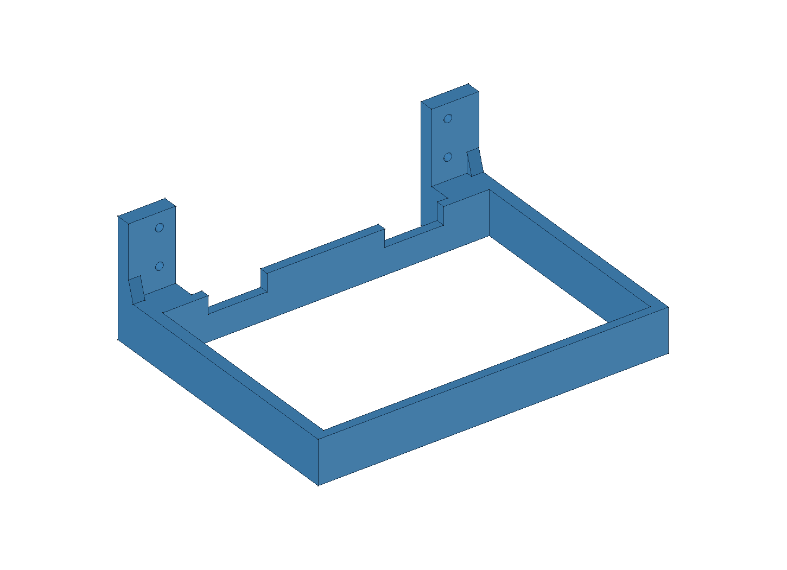
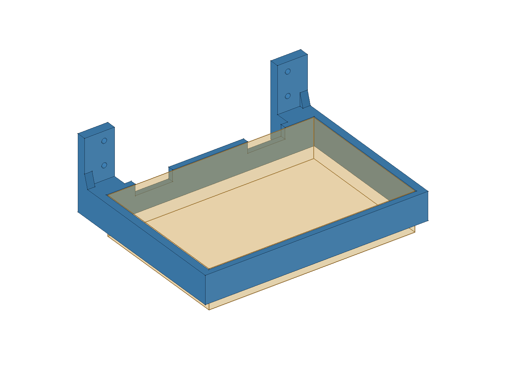

# Nástěnný držák krabičky LaskaKit MAXI RFID

Otevřená, **bezdenná obruč** se dvěma nízkými rameny, zadními výztuhami a dvěma patkami pro přivrtání ke stěně. Krabička se má vložit shora a zachytit za skutečný přesah víka o horní hranu obruče. Boční výztuhy již nevyčnívají nad obruč po stranách krabičky. Na předběžně zvolené zadní dlouhé straně jsou dva horní výseky pro panty. Strana pantů a hloubka výseků čekají na Jiřího potvrzení; fyzický dosed, pevnost a montáž také nejsou ověřené.

[Pohled shora na dva výseky pro panty](nahled-vyseky-pantu.png) · [Návrhová ukázka 3mm přesahu víka](nahled-osazeni-vika-navrh.png) · [Zadní patky a otvory](nahled-uchyceni.png)

Oranžový poloprůhledný blok na druhém náhledu ukazuje **jen zadanou spodní část 220 × 150 × 42 mm**. Na ukázce víka je navíc **návrhový** 3mm přesah na každé straně; skutečné víko změřené není. Obě schematická tělesa jsou pouze dočasná při vytvoření PNG a nejsou součástí FCStd, STL ani 3MF.

## Rozměry a funkce

| Údaj | Hodnota | Původ |
|---|---:|---|
| Spodní část krabičky, dlouhá × krátká strana | 220 × 150 mm | Jiří, finální diktované rozměry; starších 160 mm krátké strany nahrazeno |
| Výška spodní části po otevírací spoj | 42 mm | Jiří |
| Výška obruče | 30 mm | Jiří |
| Vnitřní otvor obruče | 222 × 152 mm | Návrh: vůle 1 mm na každé straně |
| Vnější půdorys obruče | 238 × 164 mm | Odvozeno; boční ramena 8 mm, čelní a zadní strana 6 mm |
| Celková tisková obálka s patkami | 238 × 189 × 80 mm | Kontrola CAD; patky jsou návrhově 15 mm za zadní hranou obruče |
| Upevnění | 2 patky po 32 mm; 4 průchozí otvory Ø5,5 mm | Návrh; typ šroubů a stěny neznámý |
| Přesah víka za spodní část | přibližně 3–4 mm na každé straně | Jiřího odhad při revizi; dosud nepřeměřeno |
| Opření víka o horní lem | přibližně 2–3 mm na každé straně | Návrhový výpočet z 1mm vůle; platí při vystředěné krabičce a skutečném přesahu 3–4 mm |
| Výseky pro panty | 30–70 a 150–190 mm od levého boku 220mm části; hloubka 12 mm od horní hrany | Podélné polohy zadal Jiří; hloubka a strana u zdi jsou předběžná volba |

Dlouhá strana 220 mm je podél stěny, krátká 150 mm vyčnívá do místnosti. Pokud se víko zachytí o horní hranu obruče, dno spodní části krabičky bude přibližně **12 mm pod spodní hranou držáku**. Zadní patky mají dvě řady děr ve výšce 45 a 70 mm. Výztuhy leží **za zadní hranou obruče**; kontrola CAD potvrdila, že v prostoru obruče nic nepřesahuje nad její 30mm horní rovinu. Výseky berou horních 12 mm zadní stěny, spodních 18 mm pod nimi zůstává spojitých. Po délce zadaných 220 mm tak horní opěrný lem tvoří úseky **0–30, 70–150 a 190–220 mm**, mezi nimi jsou dvě 40mm mezery pro panty.

Před volbou tiskové verze je potřeba potvrdit, **na které dlouhé straně jsou panty** a **jak hluboký horní výsek vyžadují**. Zatím je zakreslená strana u zdi a 12 mm. Na konkrétní krabičce pak ověřit skutečnou spodní část, vnější půdorys víka a zda přibližný přesah 3–4 mm opravdu dosedne na obruč. Bez dostatečného přesahu by bezdennou obručí propadla. Pro montáž je třeba také hmotnost naplněné krabičky, vhodné šrouby/hmoždinky a materiál stěny. CAD ani slicer nedokazují nosnost nebo fyzický fit.

## Soubory

- [drzak.FCStd](drzak.FCStd) — editovatelný FreeCAD dokument; měnit `Parametry (mm) – upravit sloupec B`.
- [drzak.FCMacro](drzak.FCMacro) — zdroj geometrie; regeneruje FCStd, STL a kontrolní JSON, nepřegeneruje PNG ani tiskový projekt.
- [nahled.FCMacro](nahled.FCMacro) — vytvoří skutečné CAD náhledy a uloží FCStd s viditelným jen finálním dílem.
- [stl/drzak.stl](stl/drzak.stl) — jeden kus v mm, tisknout plochou spodní hranou obruče na podložce.
- [kontrola-modelu.json](kontrola-modelu.json) — výsledky geometrických a parametrických kontrol.
- [rozlozeni/README.md](rozlozeni/README.md) — jedna připravená podložka pro Anycubic Kobra X 0,4 mm, procesní profil a záznam místního řezání.
- [historie původní varianty](historie/pred-vyseky-pantu-a-upravou-boku/) — kopie před revizí bočních výztuh, bez tvrzení o fyzickém tisku.

Při změně FCStd je nutné znovu exportovat STL, vytvořit náhledy a aktualizovat 3MF. Makro přepíše své výstupy ve stejné složce; před spuštěním uložit případné vlastní změny a sladit nové výchozí hodnoty se zdrojem.

## Kontrola počítačem

- FreeCAD: **1 platný solid**, půdorys obruče 238 × 164 mm, tisková obálka 238 × 189 × 80 mm; žádný materiál nad horní rovinou obruče v jejím půdorysu, oba horní výseky průchozí do stěny a spodní část stěny pod nimi spojitá. Stav uloženého FCStd a nové náhledy doplňuje kontrolní JSON.
- STL: **uzavřená síť**, jeden souvislý tiskový díl.
- Parametrický přepočet prošel při změně délky krabičky, její hloubky, vůle a výšky obruče s návratem na finální hodnoty.
- Skutečný tisk, poloha a rozměr pantů, fit víka, nosnost a vhodnost zvoleného materiálu či kotvení čekají na fyzické ověření.
