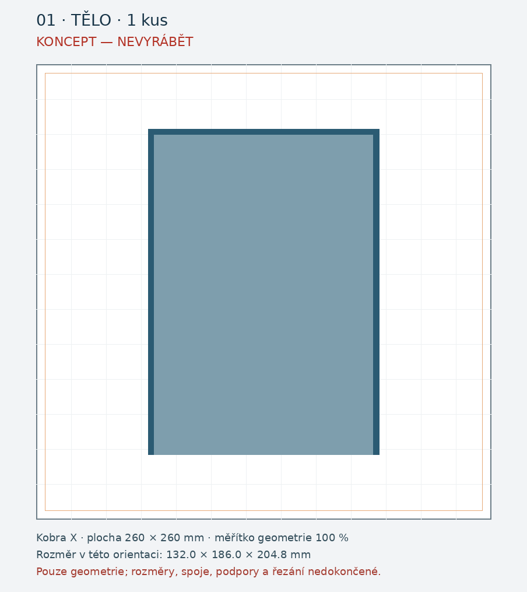
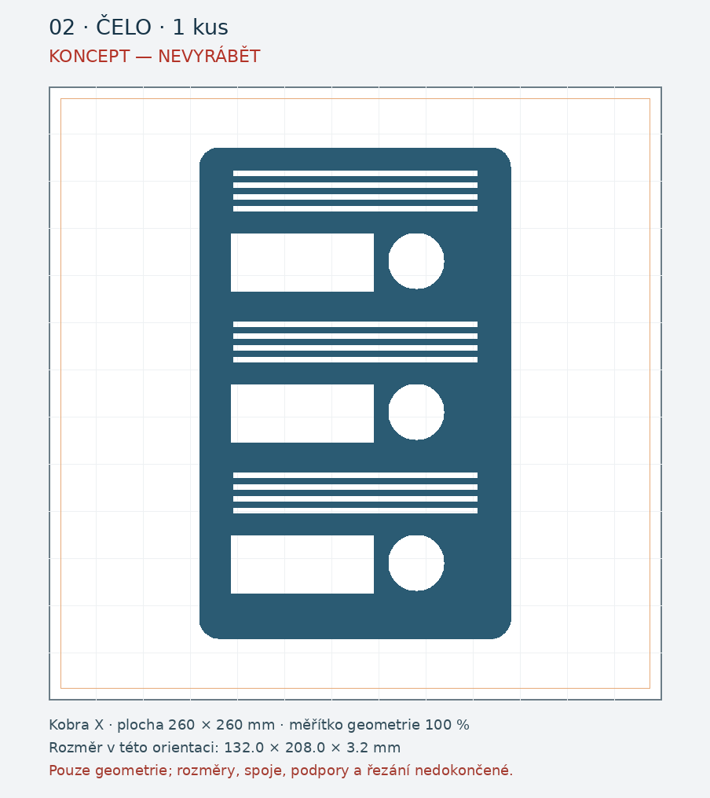
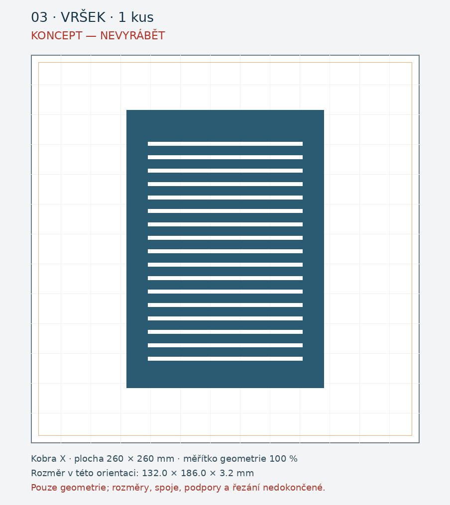
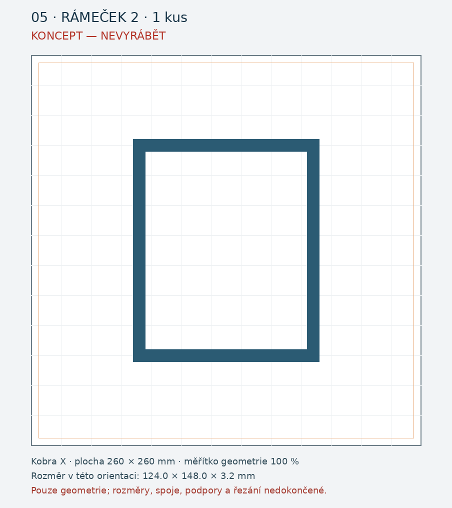

# KONCEPT — NEVYRÁBĚT

Šest předběžných podložek pouze pro prohlídku rozmístění konceptu. **Nejde o dokončený tiskový projekt ani o finální náhradu požadovaných hotových tiskových podložek.** Rozměry jsou zástupné návrhové hodnoty; tisk čeká na měření zesilovačů a konektorů, dokončení spojů a uchycení, výběr materiálu a ověření ve sliceru včetně skutečně nastavených podpor a kontroly vrstev.

Každý soubor 3MF obsahuje **jeden fyzický díl** v měřítku 100 %, bez tiskového, materiálového nebo strojového presetu, podpor a G-code. Referenční PCB, chladiče, ventilátory, knoflíky ani konektory nejsou součástí podložek. Obálka 260 × 260 × 260 mm odpovídá Kobra X; sama není nastavením tiskárny.

| Podložka | Díl | Počet | Předběžná orientace |
|---|---|---:|---|
| [01](podlozka-01-telo-KONCEPT-NEVYRABET.3mf) | Tělo | 1 | Z jako v exportu, dno na Z = 0 |
| [02](podlozka-02-celo-KONCEPT-NEVYRABET.3mf) | Čelo | 1 | Čelní plocha na podložce; původní tloušťka Y je tisková Z |
| [03](podlozka-03-vrsek-KONCEPT-NEVYRABET.3mf) | Vršek | 1 | Ploše, posunutý na Z = 0 |
| [04](podlozka-04-ramecek-1-KONCEPT-NEVYRABET.3mf) | Rámeček 1 | 1 | Ploše, posunutý na Z = 0 |
| [05](podlozka-05-ramecek-2-KONCEPT-NEVYRABET.3mf) | Rámeček 2 | 1 | Ploše, posunutý na Z = 0 |
| [06](podlozka-06-ramecek-3-KONCEPT-NEVYRABET.3mf) | Rámeček 3 | 1 | Ploše, posunutý na Z = 0 |

Celkem **6 skutečných kusů na 6 podložkách**. Každý 3MF se pro prohlídku otevírá samostatně jednou; nic se nemnoží. Toto rozdělení není ještě optimalizovaný finální tiskový plán.

Generátor [pripravit-koncept.py](pripravit-koncept.py) čte pouze šest výslovně uvedených STL z `../stl/`, porovnává jejich SHA-256 s kontrolním CAD reportem a při regeneraci přepisuje zdejší konceptní 3MF, PNG a manifest. Kontroluje uzavřené hrany, orientaci trojúhelníků, jednu souvislou skořepinu a kladný objem, vycentrování na podložce, okraje alespoň 5 mm, uložení na Z = 0 a výšku do 260 mm. Výstupní ZIP/XML opět načte a ověří počet objektů a souřadnice. Samoprůniky sítě samostatně nezkoumá.

Spuštění z tohoto adresáře: `python3 pripravit-koncept.py`. Vyžaduje Python 3 a Pillow; nevyžaduje ani nemění slicer. Podrobné výsledky a hashe obsahuje [manifest.json](manifest.json).

Očíslované PNG jsou skutečné půdorysné projekce transformovaných trojúhelníků STL; nejsou to náhledy vrstev ani drah. Prostor pod výstupky a vodorovné vrcholy větracích otvorů těla vyžadují samostatné posouzení podpor a mostů až po dokončení geometrie.

