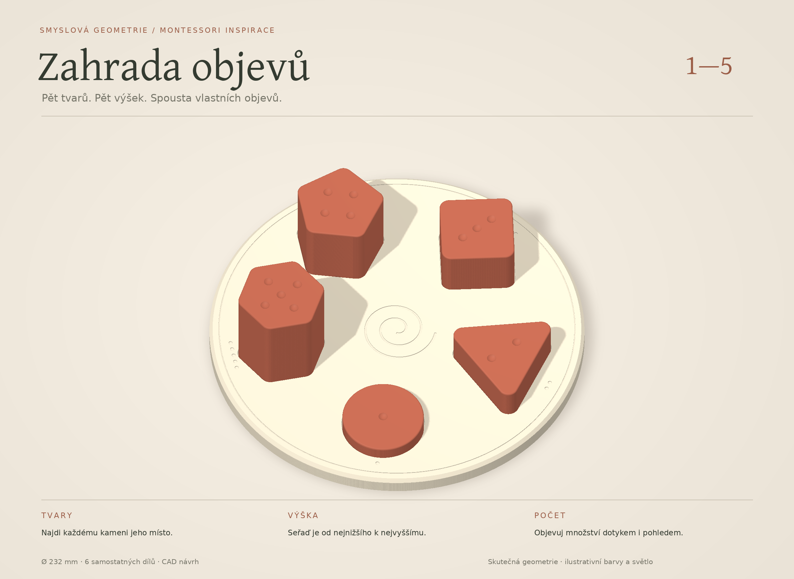

# ZAHRADA OBJEVŮ — Montessori inspirovaná hračka

**Pět velkých hmatových kamenů a jedna sochařská základna.** Každý kámen má jiný oblý tvar, jeden až pět důlků a výšku přesně **12 × počet důlků**. Dítě může přiřazovat tvary, řadit výšky, počítat dotykem, porovnávat součty a volně stavět. Zapuštěná spirála uprostřed přidává klidné vedení prstu.

Autorský návrh z 14. 10. 2026 podle zadání „luxusní a geniální promakaná montesori hračka“. Věk **3–5 let je návrhový předpoklad**, uživatel jej nepotvrdil. Rozměry, vůle a paleta jsou návrhové hodnoty. Jde o **digitálně ověřený tiskový prototyp**, ne o fyzicky odzkoušenou nebo certifikovanou hračku.

## Soubory

- [Editovatelný FreeCAD dokument](zahrada.FCStd) a [zdrojové makro](zahrada.FCMacro).
- [Tiskový balíček — STL a dvě nastavené podložky](tiskovy-balicek.zip).
- [Podložka 01 — základna](rozlozeni/podlozka-01-kobra-x-pla-projekt.3mf).
- [Podložka 02 — všech pět kamenů](rozlozeni/podlozka-02-kobra-x-pla-projekt.3mf).
- [Profil a výsledky řezání](rozlozeni/README.md).
- [Skutečný náhled přímo z FreeCADu](nahled-cad.png), [pohled shora](nahled-cad-shora.png), [hra s výškovou řadou](nahled-hry.png).

Každou podložku otevřít **jednou jako celý projekt** v Anycubic Slicer Next. Obsahuje všechny požadované kopie, měřítko i orientaci; nic nemnožit ani nepřerovnávat. Tiskárna **Anycubic Kobra X, tryska 0,4 mm**. Barvy slonové kosti a terakoty jsou výtvarný návrh; skutečná cívka, její zůstatek ani vstup podavače nebyly ověřeny. Vše funguje i v jedné barvě. Agent úlohu do tiskárny neposlal. Slicer odhaduje základnu na **12 h 16 min / 210,93 g**, kameny na **8 h 23 min / 153,54 g**; dohromady přibližně **20 h 39 min a 364,47 g PLA**. Jsou to odhady z drah, nikoli měření skutečného tisku.

## Co je promyšlené

**Stejná plocha, různé siluety.** Kruh a čtyři zaoblené pravidelné mnohoúhelníky mají v plné části průřezu shodně 2 000 mm². Kruh tedy není jen drobný díl, který by šel vsunout do velkého čtvercového otvoru. Každé sedlo vzniká přímo z obrysu odpovídajícího kamene s normálovou vůlí 0,55 mm. Skutečné záměny jsou zvlášť numericky prověřeny včetně natočení a posunu; všech 20 chybných kombinací vyloučil [numerický audit](nezavisla-kontrola-fitu.json) pro vzorkované konvexní obrysy. Nejslabší kombinace kruh → šestiúhelník má konzervativní zbytkový přesah 0,361 mm; fyzické tolerance a naklápění výpočet neověřuje.

**Číslo lze vidět i nahmatat.** Kameny mají 1–5 stejných kulových důlků hlubokých 1,2 mm. Výšky 12/24/36/48/60 mm dovolují vedle sebe ověřit například 1 + 4 = 5 nebo 2 + 3 = 5. Používat mimo sedla na společné rovině; usazení v desce výšku nad deskou o 4 mm snižuje. Výškové součty představují nominální CAD rozměr, tiskové odchylky a lehké zhoupnutí zaoblených hran se mohou projevit.

**Úchop je součástí tělesa.** Žádné nalepované knoflíky ani samostatné osičky. Nejnižší kámen z mělkého sedla vystupuje 8 mm. Hrany kamenů jsou zaoblené R1 mm; rohy půdorysů R6 mm. Kameny nejsou v základně zajištěné a při převrácení vypadnou. Věž je volná stavba bez spojek a její fyzická stabilita dosud nebyla ověřena.

**Klidný vzhled.** Všechny kameny mají stejnou barvu, aby se při tvarovém úkolu dítě nemuselo řídit barevnou nápovědou. Drobná skupina 1–5 zahloubených teček před sedlem propojuje počet s kamenem. Spirála i obvodová linka jsou zapuštěné; nic se nemusí montovat.

## Čtyři postupně zaváděné hry

1. **Najdi místo.** Nabídnout nejdřív dva různé kameny, potom všech pět. Správný kámen dosedne na dno vlastního sedla.
2. **Postav schody.** Mimo základnu seřadit kameny od nejnižšího po nejvyšší. Tvar se při této aktivitě ignoruje.
3. **Spočítej dotykem.** Přejíždět prstem přes důlky a přiřazovat skupinám teček na desce. Potom porovnávat dvě menší výšky s jednou větší.
4. **Stav a objevuj.** Stavět nízké kombinace a věž, nebo sledovat prstem spirálu od kraje ke středu. Plná věž má nominálně 180 mm; neobsahuje spojovací kolík.

Návrh je **Montessori inspirovaný**. Není kopií klasického Montessori materiálu: současně mění tvar, výšku a počet. Jednotlivé hry proto zavádět odděleně. Podkladem jsou principy [AMI — smyslové materiály](https://montessori-ami.org/node/6823) a [AMI — kontrola chyby](https://montessori-ami.org/node/7331).

## Kusovník a návrhové rozměry

| Díl | Počet | Rozměr / vlastnost | STL | Podložka |
|---|---:|---|---|---:|
| Základna | 1 | Ø232 × 12 mm, 5 sedel hlubokých 4 mm | [base.stl](stl/base.stl) | 01 |
| Kruh / 1 důlek | 1 | výška 12 mm, jmenovitý průměr 50,46 mm | [stone1.stl](stl/stone1.stl) | 02 |
| Trojúhelník / 2 důlky | 1 | výška 24 mm, rohy R6 mm | [stone2.stl](stl/stone2.stl) | 02 |
| Čtverec / 3 důlky | 1 | výška 36 mm, rohy R6 mm | [stone3.stl](stl/stone3.stl) | 02 |
| Pětiúhelník / 4 důlky | 1 | výška 48 mm, rohy R6 mm | [stone4.stl](stl/stone4.stl) | 02 |
| Šestiúhelník / 5 důlků | 1 | výška 60 mm, rohy R6 mm | [stone5.stl](stl/stone5.stl) | 02 |

Celkem **6 fyzických kusů**. Složená hračka je vysoká 68 mm. STL jsou jednotlivě posazená na Z=0 v tiskové orientaci, velikost 100 %. Sestavné STL v `vizualni-geometrie/` slouží pouze náhledu a nejsou další kusy k tisku. Pomocné CAD obálky zaoblených ploch mohou být konzervativně větší než skutečný díl; přesné obálky a rozměry STL uvádí nezávislá kontrola.

## Ověření a použití prototypu

[Kontrola modelu](kontrola-modelu.json) ověřuje šest platných samostatných solidů, nulové objemové kolize sestavy a změnu/obnovení vůle sedla i jednotkové výšky. [Nezávislé kontroly](nezavisla-kontrola.json) znovu čtou uložený model a exporty. Tiskový profil, vrstvy, dráhy a přesná vazba na předávané projekty jsou v [dokumentaci podložek](rozlozeni/README.md). Náhledy vycházejí z těchto CAD/STL souborů; světlo a barvy jsou vizualizace, nikoli fotografie.

Před hraním dospělý musí ověřit skutečné dosednutí, hladký povrch, odstranění vláken/brimu a pevnost výtisků. **Není určeno jako kousátko ani pro děti do 3 let.** Samotná velikost kamenů neřeší případné odlomené úlomky; konkrétní filament a hotový výrobek nebyly posouzeny pro dětskou hračku. První použití pod přímým dohledem dospělého, poškozený díl vyřadit. Digitální audit nedokládá odolnost při pádu, čistitelnost ani chemickou bezpečnost. K omezením domácího tisku viz [Prusa — sensory play](https://blog.prusa3d.com/diy-sensory-play-3d-print-your-own-accessories-and-let-the-kids-play_122514/) a k odlomeným malým částem [CPSC](https://www.cpsc.gov/Business--Manufacturing/Business-Education/Business-Guidance/Small-Parts-for-Toys-and-Childrens-Products).

## Regenerace

Spustit `zahrada.FCMacro` ve skutečném FreeCADu 1.1.3 podle [místního postupu](../../docs/software.md), potom `nahled.FCMacro`. Makro přepisuje pouze své FCStd, STL, sestavné STL, manifest a kontrolní JSON ve zdejší složce. Nejprve uložit a zavřít případné ruční úpravy. Všechny vazby v uloženém dokumentu jsou nativní objekty FreeCADu, bez vlastní Python třídy.

Tabulka `Parameters` řídí poloměr/výšku desky, rozteč sedel, jejich hloubku a vůli, jednotkovou výšku kamenů a velikost/hloubku důlků. Zaoblené profily jsou uložené nativní skici; jejich plocha 2 000 mm², počet stran, zaoblení hran R1, značky a spirála se mění v makru. Tabulka není neomezený konfigurátor: velké změny mohou způsobit kolize. Přímé úpravy FCStd vždy sladit i se zdrojem.

Po změně obnovit dotčené STL, audity, render `vizualizace.py`, projekty `build_print_projects.py` a balíček `zabalit.py`. Fyzický tisk, dosednutí, stabilita staveb a dlouhodobá odolnost zůstávají otevřené, dokud je nepotvrdí skutečná zkouška.
