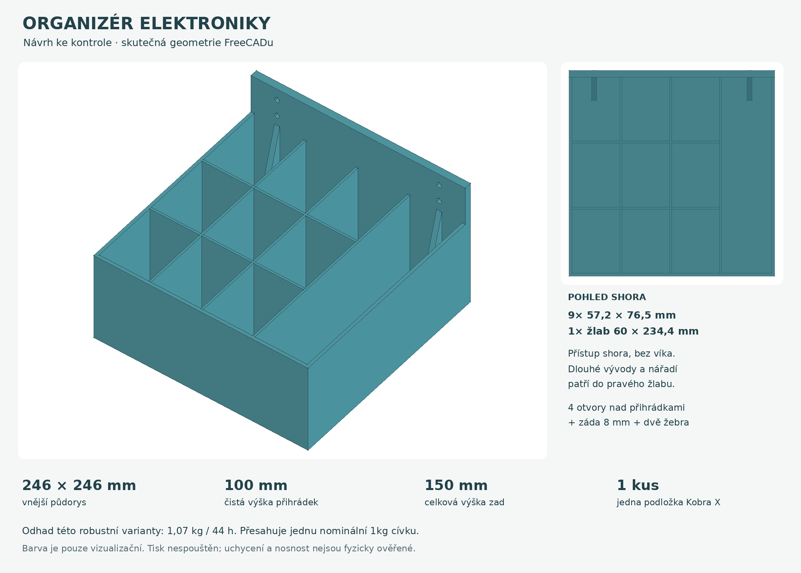

# Otevřený organizér elektroniky na zeď

**Návrh k prohlédnutí a případným úpravám, 15. 10. 2026.** Jiří naposledy upřesnil, že nyní chce dokončený návrh a vizualizaci; tisk až po jeho prohlédnutí. Žádný tisk nebyl odeslán ani spuštěn. Digitální podklady obsahují také místně vyřezaný projekt, jeho existence není schválení výroby.

## Prohlédnutí a soubory

- [Přehled návrhu](prehled-navrhu.png), [perspektivní pohled](nahled-perspektiva.png), [pohled shora](nahled-shora.png) a [pohled na montážní záda](nahled-montaz.png).
- [Parametrický FreeCAD dokument](organizer.FCStd) a synchronizované [zdrojové makro](organizer.FCMacro).
- [STL jediného dílu](stl/organizer.stl).
- [Nastavený a místně vyřezaný projekt Kobra X](rozlozeni/podlozka-01-kobra-x-pla-projekt.3mf), [návod k podložce](rozlozeni/README.md), [očíslovaný náhled podložky](rozlozeni/podlozka-01.png).
- [Kontrola modelu](kontrola-modelu.json), [nezávislá geometrická kontrola](kontrola-nezavisla.json), [kontrola řezání a drah](rozlozeni/kontrola-rezani.json).

Tyrkysová je vizualizační barva. Materiál, aktuální cívka, fyzický vstup a připravenost tiskárny nebyly ověřeny.

## Zadání a rozměry

Zadání: otevřený organizér bez víka na rezistory, tranzistory, další drobné součástky a nářadí, maximální praktický půdorys současné tiskárny, více přihrádek, zesílené šroubované uchycení ke zdi a přepážky přibližně **100 mm vysoké**. Pouze tato výška je uživatelský rozměrový požadavek; ostatní rozměry níže jsou návrhové, nikoli fyzicky změřené.

| Část | Návrhový rozměr / počet |
|---|---|
| Vnější půdorys | 246 × 246 mm |
| Čistá výška všech přihrádek | 100 mm nad dnem |
| Horní hrana přihrádek od tiskové podložky | 104 mm |
| Celková výška včetně montážních zad | 150 mm |
| Malé přihrádky | 9 × cca 57,2 × 76,53 × 100 mm |
| Dlouhý žlab na nářadí / dlouhé vývody | 1 × 60 × 234,4 × 100 mm |
| Dno / vnější stěny / přepážky | 4 / 3,6 / 2,4 mm |
| Zadní stěna | 8 mm, souvisle od dna do výšky 150 mm |
| Klínové výztuhy pod šrouby | 2 kusy, tloušťka 6 mm, dosah u dna 28 mm |
| Montážní otvory | 4 kapkové průchody zachovávající kruh Ø5,5 mm |
| Rozteč otvorů | vodorovně 186 mm, svisle 20 mm |

Mřížka 3 × 3 je pro menší součástky a sáčky. Dlouhý pravý prostor je na pinzety, malé šroubováky nebo rezistory s delšími vývody. Devět přihrádek není určeno pro devět přesně vybraných hodnot rezistorů; členění lze upravit. Při hloubce 100 mm se drobnosti na dně budou vybírat zejména pinzetou. Skutečná ergonomie rukou ani rozměry uložených součástek nejsou změřené.

U zadní levé přihrádky a dlouhého žlabu zasahuje do prostoru jedna 6mm výztuha: u dna až 28 mm od zad, směrem vzhůru se zužuje. Tabulka uvádí základní obdélníkové prostory mezi stěnami, ne objem po odečtení těchto žeber. Nad přihrádkami ponechat volný přístup shora.

## Uchycení

Souřadnice CAD: X zleva doprava, Y od čela ke zdi, Z vzhůru. Zadní dosedací plocha je rovina **Y=246 mm**; organizér vyčnívá před zeď o 246 mm. Osy šroubů jsou vodorovné, rovnoběžné s Y. Středy otvorů v rovině zad jsou **X=30 a 216 mm; Z=116 a 136 mm od spodku**. Spodní otvory jsou 12 mm nad horní hranou přihrádek.

Čtyři šrouby s podložkami lze přikládat zepředu nad přihrádkami. Pro geometrickou kontrolu je uvažována podložka vnějšího Ø12 mm a přímý přístup nástroje Ø20 mm. Jsou to kontrolní rozměry, nikoli změřené uživatelovy podložky či šroubovák. Celá 8mm zadní stěna, připojené podélné přepážky, dno a dvě klínová žebra tvoří souvislý díl. Dva sloupce otvorů omezují pootočení a rovná zadní plocha poskytuje spodní dosednutí ke zdi.

Konkrétní šrouby, hlavy, podložky, hmoždinky, typ a stav zdi ani požadované zatížení nejsou potvrzené. Volbu ukotvení je potřeba přizpůsobit skutečné zdi a ověřit na fyzickém dílu. Není stanovena ani slibována nosnost v kg; velké vyložení a dlouhodobé chování PLA zůstávají neověřené. Při dotahování plast nemačkat zapuštěnou hlavou bez vhodné opěrné plochy.

## Tisková koncepce a použitelná plocha

Ověřeny byly současné místní dokumenty a nainstalovaný profil **Anycubic Kobra X 0.4 nozzle**: plocha 260 × 260 mm, výška 260 mm, `bed_exclude_area=[]`. Model stojí plochým dnem na podložce v rozsahu X/Y **7 až 253 mm**, měřítko 1:1, jeden kus. Vnější brim 5 mm s mezerou 0,1 mm ponechává nominálně asi 1,9 mm do okraje před zohledněním konkrétní extruze; přesný skutečný rozsah cest je v kontrole řezání.

246 mm je zvolený maximální **praktický** půdorys pro tento brim a rezervu. Není to tvrzení, že hardware nedokáže větší model bez brimu. Profil nemá explicitní XY souřadnice firmwarového zavádění filamentu (`G9111`); jeho skutečný fyzický průběh nebyl měřen. Zakázané oblasti a pohyby vycházejí z dostupného profilu a vyřezaných cest, nikoli z nové fyzické inspekce tiskárny.

Svislé stěny rostou přímo ze dna. Klínová žebra se vzhůru zužují a kruhové montážní otvory doplňuje tečná 45° střecha, takže nevzniká velký vodorovný strop. Podpory jsou v projektu vědomě vypnuté a konkrétní vrstvy otvorů byly zahrnuty do kontroly drah. Brim řeší přilnavost, nikoli převisy. Velké ploché dno může při skutečném tisku pracovat; digitální řez neprokazuje přilnavost ani rovinnost hotového dílu.

**Odhad sliceru: 44 h 01 min 46 s / 1 066,92 g.** Tato robustní varianta překračuje jednu nominální 1kg cívku, navíc je nutná rezerva. Jde o podstatný údaj pro posouzení návrhu; dostupný zůstatek a případné pokračování z další cívky nejsou ověřeny. Na přání lze později odlehčit stěny či změnit členění při zachování zadané výšky 100 mm.

Přípravný materiálový profil je **návrh pro Alzament PLA Basic 1,75 mm** na Kobra X, nikoli potvrzení založené cívky: 215/205 °C tryska, 50 °C podložka, vrstva 0,24 mm (první 0,20), 5 stěn, 25 % gyroid, 5 horních i spodních vrstev, rychlosti stěn 50/75 mm/s, MVS 8 mm³/s. Podrobné skutečně uložené nastavení, varování a rozsah kontrol uvádí [přehled podložky](rozlozeni/README.md).

## Editovatelnost a regenerace

`organizer.FCStd` používá standardní FreeCAD boxy, válce, náčrty, extruze a booleovské operace s výrazy navázanými na tabulku `Parameters`. Přepočet nepotřebuje vlastní Python třídu. Žluté buňky jsou návrhové vstupy; zelená hodnota `BinDepth=100 mm` zachovává uživatelské zadání. Rozměry otvorů a žeber i jejich poloha sledují šířku, hloubku a výšku přihrádek.

Při úpravě uloženého FCStd slaď vstupy i v `organizer.FCMacro`; jinak další regenerace změnu ztratí. Makra mají výstupní cesty odvozené od své vlastní složky a přepisují pouze zdejší pojmenované soubory. Po změně geometrie je potřeba nový STL, náhled, kontrola a nové řezání.

Pořadí: `organizer.FCMacro` ve FreeCADu → `nahled.FCMacro` v GUI FreeCADu → `kontrola-nezavisla.FCMacro` → `python3 rozlozeni/pripravit-podlozku.py` → `python3 sestav-prehled.py`. Poslední skript jen skládá skutečné CAD náhledy a popisky. Podrobný běhový postup je v [dokumentaci softwaru](../../docs/software.md). Makro nenahradí systémový Python bez modulů FreeCADu.

## Stav a omezení důkazů

Digitálně ověřeno: jeden platný solid, uzavřená souvislá STL, rozměry a parametrický přepočet; uložená viditelnost pouze finálního dílu; samostatně kontrolované dutiny, průchody a montážní přístup; jeden kus v nastaveném 3MF a místní řezání se skutečnými vrstvami. Podrobné výsledky a hashe jsou v odkazovaných JSON.

Přesný rozsah kontroly drah: všech 625 vrstev obsahuje extruzi a jejich obálka je uvnitř podložky. Prohlédnuté jsou vybrané skutečné vrstvy včetně dna, přepážek a detailu čtyř otvorů. Dodatečný výpočetně náročný grafový test nových ostrůvků skončil po 45 s na 7 z 625 vrstev; v prověřené části nic nenašel, **úplnou spojitost všech drah tím neprokázal**. Jeho výsledek je veden jako nedokončený, nikoli jako úspěch. Slicer navíc uvádí informační varování časosběru a CLI hlášku `calc_exclude_triangles`; podrobnosti jsou v protokolu řezání.

**Dalším krokem je Jiřího prohlédnutí návrhu.** Fyzický tisk, výběr a dostatek filamentu, první vrstva, montáž, rovinnost, pevnost a nosnost nejsou ověřené. Nebyla ovládána tiskárna. Nebyl proveden commit ani push.
