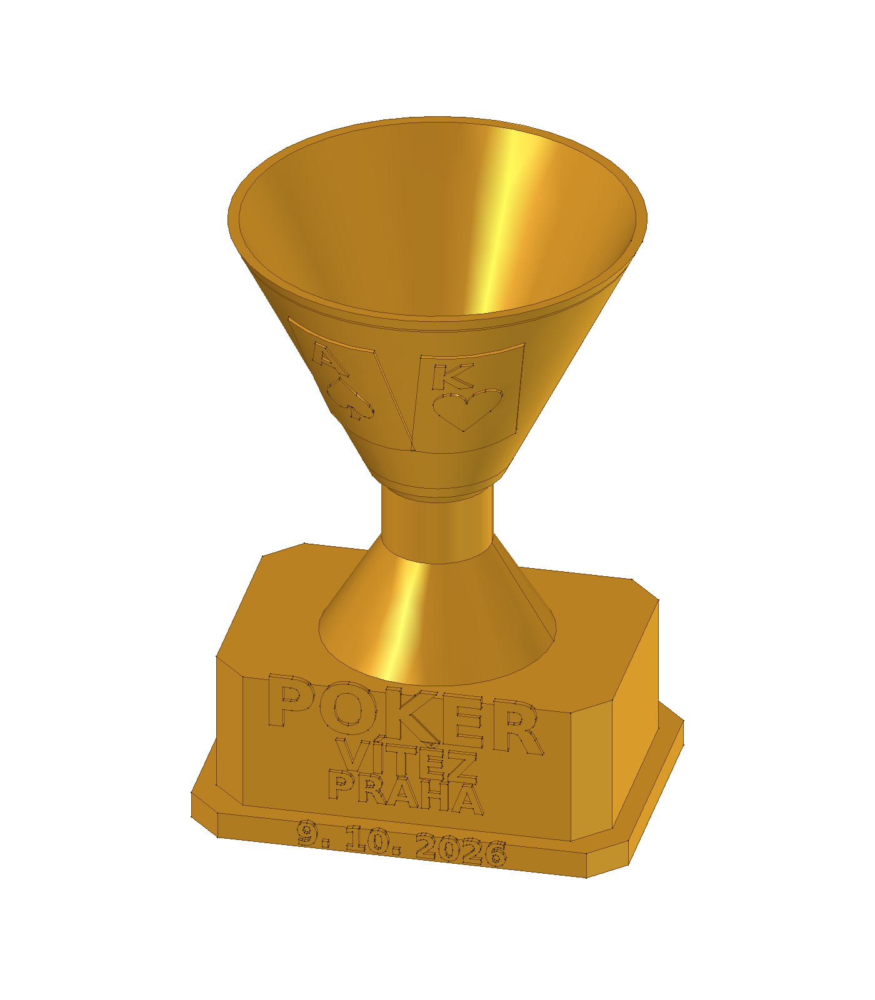

# Zlatý pokerový pohár — Praha 9. 10. 2026

**Digitálně hotovo: parametrický CAD, uzavřené STL a skutečně nařezaný projekt pro 1 pohár.** Odhad Anycubic Slicer Next je **1 h 44 min 18 s / 31,15 g** zlatého PLA Silk; proti požadovaným dvěma hodinám zbývá asi 15 minut. Odhad není naměřený čas tisku.

Tento model dodal původní chat **„Zlatý pokerový pohár“ dne 9. 10. 2026**. Pokud sem později přijde opožděný executor se stejným zadáním, **nepřepisovat hotové artefakty; pouze ohlásit jejich existenci**. Další úpravy musí vycházet z nového zadání uživatele.

## Použít k tisku

Otevřít [podložku 01 — nastavený 3MF projekt](rozlozeni/podlozka-01-kobra-x-zlaty-silk-projekt.3mf) **jednou jako celý projekt** v Anycubic Slicer Next. Obsahuje jednu fyzickou kopii, orientaci nastojato, profil Kobra X 0,4 mm, jeden logický zlatý filament, skutečné dráhy a G-code. Nic nerozmnožovat ani nepřerovnávat.

Před spuštěním ověřit založenou **zlatou Alzament PLA Silk Gold 1,75 mm** a její fyzický vstup. Materiál je v [kanonické evidenci](../../docs/materialy.md); nynější slot ani zbývající hmotnost cívky nejsou ověřené. Agent tiskárnu neovládal a úlohu neodeslal.

Návrhové nastavení: vrstva 0,24 mm, první 0,20 mm, 2 stěny, 10 % gyroid, 4 horní/dolní vrstvy, 220 °C tryska a 50 °C podložka, vnější stěny 50 mm/s, objemový tok nejvýše 5,5 mm³/s. Podpory vypnuté, vnější brim 3 mm, čisticí věž vypnutá. Jde o počáteční profil pro doložený Silk, nikoli fyzicky kalibrovaný profil. [Podrobný návod a přehled podložky](rozlozeni/README.md).

## Návrh a soubory

Jednodílný pohár má otevřenou misku, zesílený horní okraj, dřík a stabilní osmiúhelníkový podstavec. Na misce jsou dvě reliéfní karty **A♠ a K♥**, na podstavci **POKER / VÍTĚZ / PRAHA / 9. 10. 2026**. Vše tisknout jednou barvou. Zlatý náhled je vizualizace geometrie, nikoli fotografie výtisku nebo důkaz založené cívky.

Všechny rozměry jsou **návrhové volby agenta**, uživatel žádné rozměry nezadal: celková analytická CAD obálka **64 × 60 × 92 mm**, podstavec 64 × 46 mm, horní průměr misky 60 mm, radiální stěna misky 1,6 mm. STL síť má hloubku 59,981 mm kvůli polygonální aproximaci kruhu, odchylka proti CAD je pod 0,02 mm.

| Soubor | Účel |
|---|---|
| [pokerovy-pohar.FCStd](pokerovy-pohar.FCStd) | Editovatelný parametrický FreeCAD, tabulka a standardní nativní objekty |
| [pokerovy-pohar.FCMacro](pokerovy-pohar.FCMacro) | Zdroj geometrie, nápisů a exportu |
| [STL](stl/pokerovy-pohar.stl) | Jeden uzavřený tisknutelný model |
| [Nastavený 3MF](rozlozeni/podlozka-01-kobra-x-zlaty-silk-projekt.3mf) | Hlavní podložka 01, jedna kopie včetně procesu a řezu |
| [Náhled zepředu](nahled-predek-cad.png) | Skutečná CAD geometrie |
| [Očíslovaná podložka](rozlozeni/podlozka-01.png) | Poloha a počet 1 kus |
| [Vybrané skutečné vrstvy](rozlozeni/podlozka-01-vrstvy.png) | Kontrola drah data, nápisů, karet, misky a brimu |
| [Kontrola modelu](kontrola-modelu.json) | Geometrie, zdroj, STL a parametrický test |
| [Nezávislé znovuotevření](nezavisla-kontrola.json) | Ověření uloženého FCStd, viditelnosti, hashů a exportu |
| [Kontrola řezu](rozlozeni/kontrola-rezani.json) | 3MF, skutečné dráhy, parametry, čas a hmotnost |

## Provedené kontroly

Geometrie je platná a tvoří **1 solid**; STL má **24 684 trojúhelníků a 1 uzavřenou komponentu**. Nativní parametrický test změny šířky 64 → 66 → 64 mm prošel. Znovuotevřený FCStd se přepočítal bez vlastní Python třídy, má pouze finální objekt `Trophy` viditelný a souhlasí se zdrojem a kontrolním JSON. Nápisy jsou v dokumentu uložené jako standardní Part geometrie, takže otevření nepotřebuje externí font.

Kužel misky se rozšiřuje 0,5 mm na 1 mm výšky. Karty a znaky sledují jeho povrch, nejsou volně visícími deskami. Při kontrole prvního řezu byl zjištěn drobný nový ostrůvek na začátku znaku; předstup znaku nad kartou byl snížen na 0,35 mm a finální řez znovu ověřen. **384 vrstev, 0 nových odpojených ostrůvků, 0 oprav sítě, žádný přesah podložky, podpory nevznikly.** Kontrola spojitosti drah nenahrazuje fyzické posouzení každého převisu. Zkontrolovány vrstvy první vrstvy, začátku data, nápisů, opravených znaků a okraje misky; odpovídající CAD náhled byl obnoven.

Slicer má pouze informační varování k nepodporovanému tradičnímu časosběru; jeho neblokující CLI hlášení a rozsah ověření jsou uvedené v návodu podložky. **Fyzický tisk, lesk, čitelnost drobných detailů a odstranění brimu zůstávají neověřené.**

## Regenerace

Makro spustit skutečným FreeCADem 1.1.3 podle [návodu](../../docs/software.md), nikoli systémovým Pythonem. Přepíše zdejší FCStd, STL a kontrolu modelu; před spuštěním zavřít dokument a uložit případné ruční změny. Tabulka ovládá nativní konstrukční rozměry. Nápisy, obrysy karet a jejich polohy se mění v makru; změnu tabulky a makra vždy sladit. Pro regeneraci obrysů se používá systémový DejaVu Sans Bold.

Po geometrické změně spustit `nahled.FCMacro` pro obnovení PNG a uložené viditelnosti, `nezavisla-kontrola.FCMacro` pro znovuotevření a `python3 rozlozeni/pripravit-podlozku.py` pro nové podložky a řezání. Otevření stávajícího FCStd makro nevyžaduje. Při změně geometrie znovu ověřit čas do dvou hodin a skutečné dráhy. Geometry-only 3MF je alternativa stejné kopie bez procesu a neslouží jako další výtisk.
