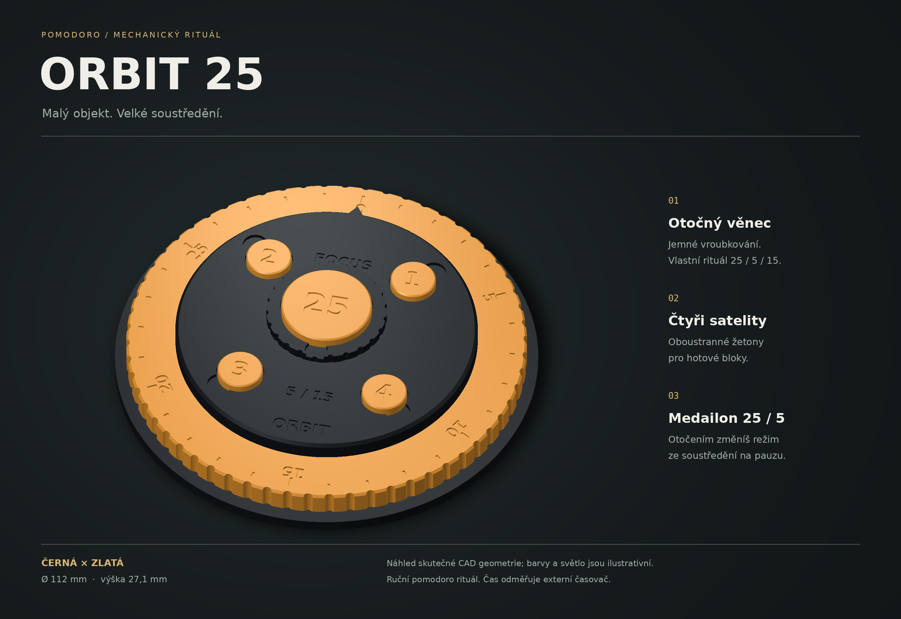

# ORBIT 25 — mechanická pomodoro hračka

**Černé tělo, zlatý otočný věnec, oboustranný medailon 25/5 a čtyři satelity dokončených bloků.** Navrženo 14. 10. 2026 podle Jiřího zadání „luxusní a geniální promakaná pomodoro hračka“. Model tvoří devět čistě tištěných dílů, bez lepidla, kovových šroubů a elektroniky.

Je to **ruční pomodoro pomůcka a stolní fidget**. Nemá hodinový strojek, samočinný odpočet ani zvuk; skutečný čas měří telefon nebo jiný časovač. Věnec se otáčí plynule, nemá západky. Celkové návrhové rozměry jsou **Ø112 × 27,05 mm**. Uživatel žádné rozměry nezadal.

## Otevřít a vytisknout

- [Editovatelná sestava FreeCAD](orbit.FCStd), [zdrojové makro](orbit.FCMacro).
- [Podložka 01 — černá PLA Basic, 3 kusy](rozlozeni/podlozka-01-kobra-x-pla-projekt.3mf).
- [Podložka 02 — zlatá PLA Silk, 6 kusů](rozlozeni/podlozka-02-kobra-x-pla-projekt.3mf).
- [STL a tiskové projekty v jednom ZIP](tiskovy-balicek.zip).
- [Profil, odhady a kontroly tiskových podložek](rozlozeni/README.md).
- [Náhled shora](nahled-shora-design.png), [rozložená sestava](nahled-rozlozeno.png).

Každou 3MF otevřít **jednou jako celý projekt** v Anycubic Slicer Next. Jsou to dvě různé podložky se všemi fyzickými kusy; nic nemnožit ani nepřerovnávat. Geometry-only soubory jsou pouze alternativy stejných podložek bez procesu, ne další kusy k tisku. Slicer odhaduje dohromady **6 h 45 min a 87,80 g** (černá 4 h 25 min / 62,23 g, zlatá 2 h 20 min / 25,57 g). Obě konfigurace jsou pro **Anycubic Kobra X, tryska 0,4 mm**. Barvy v náhledu jsou návrhové; před tiskem přiřadit skutečnou cívku/vstup. Aktuální zůstatek materiálu ani slot není ověřený. Agent úlohu nikam neposlal.

## Co je na tom promyšlené

Věnec má 60 hmatových drážek a 30 minutových dílků, číslovaných po pěti od 0 do 25. Otáčí se na širokém válcovém vedení a shora jej zachycuje pevná koruna. Koruna dosedá na vlastní doraz a je zajištěná třemi vodicími kolíčky; utažení středového šroubu proto nemá stlačit věnec. Radiální vůle věnce je 0,4 mm, axiální 0,5 mm.

Velký středový šroub má hrubý tištěný závit se stoupáním 3,6 mm a kuželovou hlavici, kterou lze uchopit prsty. Otevřená kapsa medailonu i kužel jsou orientované vzhůru při tisku. Kapsa tak nevyžaduje velký překlenovaný strop ani uzavřené podpory. Ženský závit má návrhovou normálovou vůli 0,3 mm na bocích.

Medailon je z jedné strany označen **25**, z druhé **5**. Při přepnutí medailon vyjmout, zvednout přibližně 15 mm nad dosed, obrátit a vrátit; neotáčet jej napříč uvnitř jamky. Čtyři menší žetony mají na jedné straně prázdný kroužek a na druhé číslo 1–4. Symboly jsou na obou stranách zahloubené: po otočení dosedá plochý obvod, nikoli vystouplé číslice. V kapsách jsou výřezy na prst. Medailon i žetony jsou **volně vyjímatelné a při převrácení celé hračky mohou vypadnout**; koruna a věnec jsou zajištěné šroubem.

## Složení

1. Odstranit brim, otřepy a případná vlákna, hlavně z vedení a závitu. Nic nelepit.
2. Nasadit věnec na základnu, stupnicí nahoru. Má jít volně otáčet.
3. Položit korunu tak, aby tři slepé otvory na spodku zapadly na tři kolíčky základny. V náhledu šipka míří nahoru k nule.
4. Středový šroub vložit skrz korunu a zašroubovat **rukou lehce k dosedu**. Nepoužívat kleště; pokud drhne nebo věnec stojí, nejprve vyčistit funkční plochy a ověřit fit. Šroub dosedá do kuželového sedla koruny, koruna na horní plochu vedení.
5. Vložit čtyři žetony do kapes a medailon do hlavice. Není nutná žádná kovová součástka.

Fyzický chod závitu, vůle tiskárny, tření a povrch Silk se musí potvrdit prvním výtiskem. CAD kontrola není fyzická kalibrace.

## Pomodoro rituál

1. Čtyři žetony otoč prázdným kroužkem nahoru. Medailon dej stranou **25** nahoru a věnec natoč na 25 pod pevnou šipku. Spusť externí časovač na 25 minut.
2. Po dokončení otoč jeden žeton číslem nahoru a medailon na **5**. Nastav věnec i externí časovač na 5 minut.
3. Opakuj čtyři bloky. Po čtvrtém lze věncem označit delší pauzu 15 minut a resetovat žetony.

Věnec je ruční značka intervalu nebo průběhu; čas se na něm neposouvá sám. Hraním s věncem se mění jeho nastavení. Počet hotových bloků zůstává zaznamenaný žetony.

## Kusovník

| Díl | Počet | STL | Podložka |
|---|---:|---|---:|
| Základna s vedením a vnitřním závitem | 1 | [base.stl](stl/base.stl) | 01 |
| Pevná koruna | 1 | [crown.stl](stl/crown.stl) | 01 |
| Ruční šroub s kapsou | 1 | [screw.stl](stl/screw.stl) | 01 |
| Otočný zlatý věnec | 1 | [rotor.stl](stl/rotor.stl) | 02 |
| Žeton 1 | 1 | [token1.stl](stl/token1.stl) | 02 |
| Žeton 2 | 1 | [token2.stl](stl/token2.stl) | 02 |
| Žeton 3 | 1 | [token3.stl](stl/token3.stl) | 02 |
| Žeton 4 | 1 | [token4.stl](stl/token4.stl) | 02 |
| Oboustranný medailon 25/5 | 1 | [modemedallion.stl](stl/modemedallion.stl) | 02 |

STL jsou jednotlivě orientovaná pro tisk a posazená na Z=0. Sestavné STL v `vizualni-geometrie/` slouží pouze renderu; nejsou další tiskové kusy. Analytické průměry jsou 112 mm základna, 106 mm obálka věnce, 80 mm koruna (šipka přidává 2 mm na jedné straně), 32 mm obálka hlavice, 12 mm žetony a 24 mm medailon. Jemné fazety STL jsou aproximací zakřivení, nikoli změnou návrhových rozměrů.

## Ověření a hranice výsledku

[Kontrola modelu](kontrola-modelu.json) ověřuje devět platných samostatných solidů, devět uzavřených jednosložkových STL a nulové objemové kolize složené sestavy. Změna radiální vůle 0,4 → 0,5 → 0,4 mm změnila otvor věnce a po obnovení vrátila původní objem. Konstrukce používá nativní objekty FreeCADu, výrazy a tabulku; přepočet nevyžaduje vlastní Python třídu.

[Nezávislá kontrola](nezavisla-kontrola.json) zachycuje znovuotevření uloženého modelu, pohyb a kontrolu vazby na STL. [Kontrola řezu](rozlozeni/kontrola-rezani.json) patří ke konkrétním předávaným 3MF a jejich vrstvám. Náhledy vznikly ze skutečné CAD/STL geometrie; barvy a světlo jsou vizualizace, nikoli fotografie.

**Fyzický tisk, fit závitu, lehkost otáčení, životnost, čitelnost detailů a vzhled filamentu zatím nebyly ověřeny.** Stav je digitální tiskový prototyp. Uživatel tisk nespustil ani nepotvrdil jeho výsledek v rámci tohoto zadání.

## Regenerace a úpravy

Použít skutečný FreeCAD 1.1.3 podle [místního návodu](../../docs/software.md), nikoli systémový Python. `orbit.FCMacro` přepíše zdejší `orbit.FCStd`, tiskové STL, sestavné STL pro render, manifest a kontrolní JSON. Předem uložit a zavřít ruční úpravy dokumentu.

Tabulka `Parameters` řídí hlavní rozměry, vůle a nativní závit. Polohy dekorací, font, medailon a některé montážní detaily se upravují v makru; tabulka tedy není univerzální konfigurátor libovolných rozměrů. Přímé změny tabulky vždy sladit s makrem. Textové obrysy jsou uložené ve FCStd, který pro otevření font nepotřebuje; regenerace používá DejaVu Sans Bold.

Po změně spustit `nahled.FCMacro` pro viditelnost a náhledy, `nezavisla-kontrola.FCMacro`, render `vizualizace.py` a `python3 rozlozeni/pripravit-podlozky.py`. Přegenerovat i ZIP a znovu ověřit pouze dotčenou geometrii/podložku. Slicer vytváří procesní JSON i samostatné projekty; nemění uložené globální presety uživatele.
