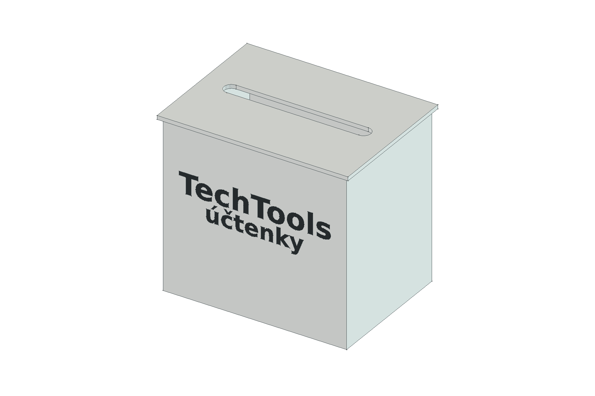
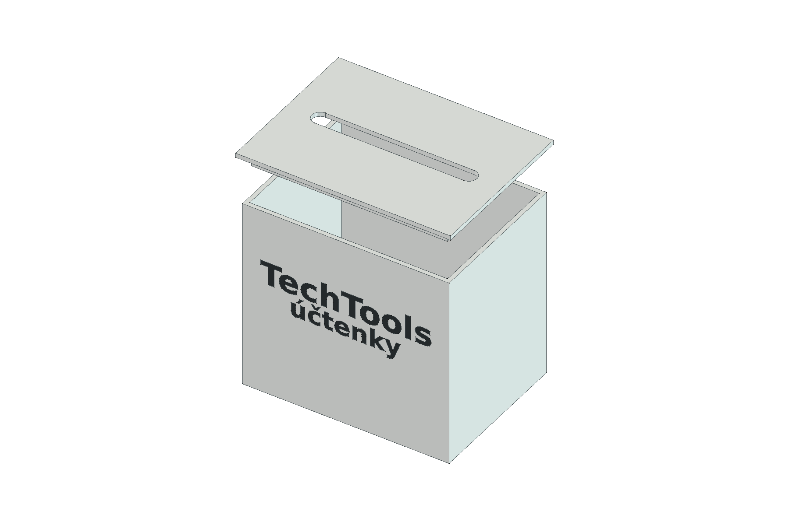

# Schránka na účtenky TechTools

Dvoudílná stolní schránka. Účtenky se během roku vhazují štěrbinou ve víku; na konci roku se víko celé zvedne a obsah se vyjme otevřeným vrchem. Bílá přední stěna má **černý vložený nápis „TechTools účtenky“ ve dvou řádcích**. Jde o tisk dvou barev v jednom projektu, bez dodatečného barvení či lepení. Text není ověřené firemní logo. Návrh je určený k Jiřího vlastnímu tisku.

## Rozměry a mechanismus

Všechny rozměry v této tabulce jsou **návrhové volby agenta v mm**. Jiří žádný rozměr nezadal ani nezměřil.

| Prvek | Nominální CAD rozměr |
|---|---:|
| Tělo, vnější šířka × hloubka × výška | 150 × 110 × 138 |
| Víko, vnější půdorys; celková výška v tiskové poloze | 156 × 116; 11,2 |
| Celková výška sestavy | 141,2 |
| Světlý půdorys a výška těla nad dnem | 143,6 × 103,6 × 134,4 |
| Stěny / dno / deska víka | 3,2 / 3,6 / 3,2 |
| Zaoblená průchozí vhazovací štěrbina | 120 × 12 |
| Zasouvaná obruba víka | 8 hluboká; stěna 2,6 |
| Nominální vůle obruby vůči vnitřku těla | 0,65 na každé straně |
| Přesah víka pro uchopení | 3 na každé straně |
| Barevný nápis TechTools / účtenky | 18 / 14 vysoké písmo, 0,8 hluboko ve stěně; líc zarovnaný s povrchem |

Štěrbina pojme běžnou 80mm termální účtenku i širší přeložený papír. Vnitřní objem podle prostého kvádru nad dnem je přibližně 2,0 l; ve skutečné sestavě část horního obvodu zabírá obruba víka. Obruba víko jen polohuje, nemá zámek. Po vytištění se víko otočí obrubou dolů, zasune do otevřeného těla a při vyprázdnění se zvedne za přečnívající hranu. Vůle je záměrně nastavitelná, protože přesnost a smršťování konkrétního tisku nejsou známé.

## Soubory

- [schranka.FCStd](schranka.FCStd) — editovatelný FreeCAD 1.1.3 dokument s tabulkou parametrů, standardními objekty a pohledem na sestavu.
- [schranka.FCMacro](schranka.FCMacro) — zdroj těla, víka, nápisu, STL a geometrické kontroly.
- [nahled.FCMacro](nahled.FCMacro) — skutečné CAD náhledy a uložená viditelnost sestavy.
- [overit-parametry.FCMacro](overit-parametry.FCMacro) — kontrola vztahů po otevření FCStd.
- [stl/telo.stl](stl/telo.stl), [stl/napis.stl](stl/napis.stl) a [stl/viko.stl](stl/viko.stl) — tři barevné oblasti pro **dvě fyzické součásti**; jednotlivá STL nejsou samostatná vícebarevná zakázka.
- [rozlozeni/README.md](rozlozeni/README.md) — hotový dvoubarevný tiskový projekt na jedné podložce se dvěma kusy, profil a výsledek řezání.
- [kontrola-modelu.json](kontrola-modelu.json) — strojové výsledky geometrie a parametrického přepočtu.

Makro `schranka.FCMacro` při spuštění přepíše `schranka.FCStd`, tři STL a `kontrola-modelu.json` v této složce. Obrysy obou řádků jsou v FCStd uložené jako běžná Part geometrie; otevření nevyžaduje externí font ani vlastní Python třídu. Změnu textu nebo velikosti fontu je nutné provést v makru. Při změně tabulky v FCStd slaď také makro a regeneruj STL, rozložení a náhledy. Po headless regeneraci spusť `nahled.FCMacro`, aby FCStd opět ukazoval sestavu. Neuložené ruční úpravy před regenerací zálohuj.

## Ověření dne 26. 9. 2026

- FreeCAD: bílé tělo a víko mají každé **jeden platný solid**. Černý nápis tvoří 18 uzavřených oblastí jednotlivých znaků. Bílé a černé objemy se nepřekrývají; barevná vložka přesně vyplňuje odpovídající kapsy v přední stěně. Všechna tři STL jsou uzavřená. Rozměry a nominální vůle odpovídají tabulce.
- Uložený FCStd byl znovu otevřen v GUI; sestava zobrazuje tělo, barevný nápis a víko. Po opětovném otevření prošel přepočet.
- Parametrická zkouška: vůle 0,65 → 0,85 → 0,65 mm změnila šířku obruby o 0,4 mm; šířka těla 150 → 155 → 150 mm posunula centrované řádky nápisu o 2,5 mm. Geometrie zůstala platná a původní objemy se obnovily. Testovací změny nebyly zapsány do FCStd.
- Jedna podložka 3MF obsahuje přesně 1× tělo s vloženým nápisem a 1× víko na ploše Kobra X 260 × 260 mm. Nastavený projekt se dvěma filamenty prošel řezáním a kontrolou vrstev/drah. Podrobnosti a omezení jsou v [přehledu podložky](rozlozeni/README.md).

**Fyzický tisk, přilnavost, čistota přechodu barev, čitelnost nápisu, zasunutí víka a dlouhodobé používání zatím nejsou ověřené.** Jiří bude tisknout sám a případné změny vycházejí až z jeho zkoušky.
