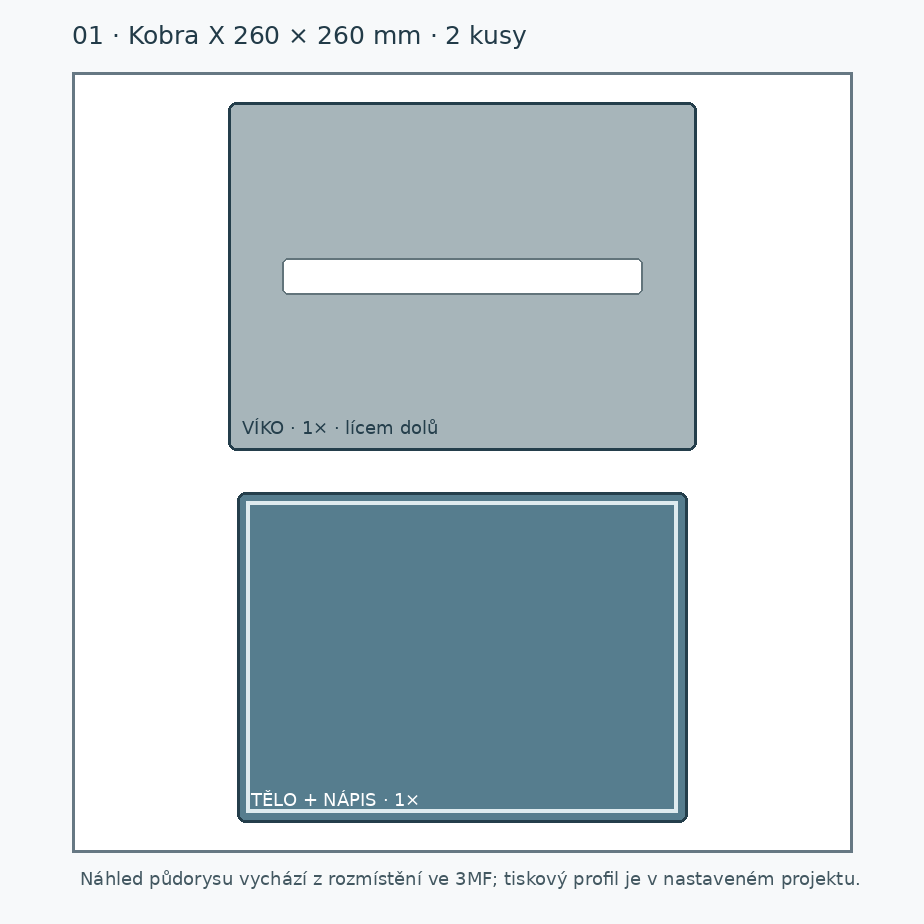
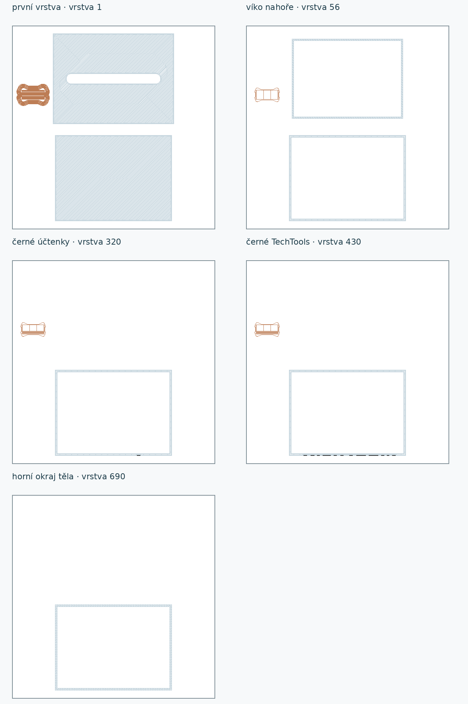

# Připravená podložka 01 — dvoubarevná schránka TechTools

| Otevřít jednou v Anycubic Slicer Next | Fyzické kusy | Barevné oblasti |
|---|---:|---|
| [podlozka-01-kobra-x-pla-projekt.3mf](podlozka-01-kobra-x-pla-projekt.3mf) | 1× tělo + 1× víko | Bílé tělo, černý nápis „TechTools účtenky“, bílé víko |

Toto je **nastavený projekt** pro Anycubic **Kobra X 0,4 mm**. Všechno je na jediné podložce; nic nekopíruj ani ručně nepřerovnávej. Tělo stojí na dně, barevný nápis je zarovnaný s přední stěnou a víko leží vnější rovnou plochou na podložce s obrubou nahoru. Po tisku se víko otočí a nasadí obrubou dovnitř. [podlozka-01-geometrie.3mf](podlozka-01-geometrie.3mf) obsahuje pouze alternativní geometrii a rozmístění **bez** profilu tiskárny, materiálů a procesu. Obě 3MF neimportuj dohromady.

## Barvy a profil

- Projekt má **dva logické filamenty PLA**: bílý pro tělo a víko, černý pro nápis. Před tiskem v sliceru ověř, že oba filamenty ukazují na skutečně založenou bílou a černou cívku a správné vstupy Kobra X. Barva náhledu sama toto fyzické přiřazení nepotvrzuje.
- Základ: místní profily **Anycubic Kobra X 0.4 nozzle** a **0.20mm Standard**. Oba filamenty jsou návrhové startovní profily `Alzament PLA Basic` odvozené od Anycubic PLA, nikoli naměřená kalibrace konkrétních cívek.
- Vrstva 0,20 mm, 3 stěny, 15 % mřížková výplň. Vnější stěna 70 mm/s, vnitřní 100 mm/s, horní povrch 60 mm/s, první vrstva 35 mm/s.
- Tryska 215 °C první vrstva / 205 °C dále, texturovaná podložka 50 °C. Tyto teploty jsou návrhové v mezích dodavatelského rozsahu Alzament PLA Basic; před spuštěním ověř skutečný typ podložky i materiál.
- Podpory jsou **vypnuté**. Tělo stojí na plném dně a víko leží vnější plochou na podložce. Vložka nápisu se během tisku tvoří uvnitř přední stěny. Projekt má zapnutou čisticí věž pro změny barvy. Brim má nastavenou automatickou volbu se šířkou 5 mm; zda vznikne, ukazuje aktuální kontrolní řez.

## Kontrola řezání

Nastavený projekt byl načten a řezán v místním Anycubic Slicer Next. Má **690 vrstev, 183 voleb tiskového nástroje a žádné varování**. Kontrola ověřila bílý extruder pro tělo a víko, černý výhradně pro nápis v přední stěně, zachované polohy a trojúhelníky bez oprav sítí, volnou štěrbinu a skutečné dráhy čisticí věže. Podpory ani brim v řezu nevznikly. Odhad sliceru je **372,24 g PLA (346,23 g bílé a 26,01 g černé včetně čištění) a 7 h 56 min**. Je to počítačový odhad podle návrhového profilu; před spuštěním ověř dostatek obou cívek. Podrobné hodnoty jsou v [kontrola-rezani.json](kontrola-rezani.json).

G-code a běhové logy zůstávají v ignorované `.cache/`, nejsou součástí předávaného projektu. Fyzická první vrstva, čistota barevného přechodu, dlouhý tisk, čitelnost nápisu a dosednutí víka čekají na Jiřího zkoušku. Žádná úloha nebyla poslána na tiskárnu.

Rozložení lze obnovit [vytvorit-podlozku.py](vytvorit-podlozku.py), nastavený projekt a kontrolní řez [nastavit-projekt.py](nastavit-projekt.py). Skripty zapisují do této složky a do ignorované `.cache/` tohoto repozitáře.
