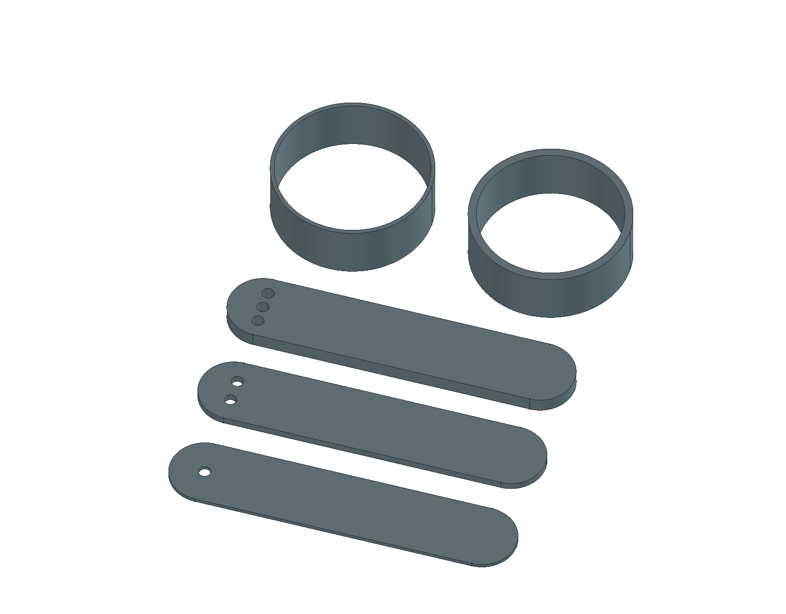

# TPU — test pružnosti

Zadání z 24. 10. 2026: malý 3D model na vyzkoušení „gumovějšího“ filamentu. Jiří potvrdil **Alzament TPU 95A**. Rozměry níže jsou návrhové hodnoty, uživatel je nezadával. Pět samostatných vzorků ukazuje vliv tloušťky na ohyb a stlačení. Jde o hmatové porovnání, nikoli měření tvrdosti Shore nebo normalizovanou tahovou zkoušku.

**Aktuální stav po pokusu:** V01 se uživateli zastavila hned na začátku s chybou11833. Připravena je [V02 bez wipe a s omezenými retrakcemi](rozlozeni/revize-02-bez-wipe/README.md), zatím jen digitálně ověřený kandidát. Závada podávání a úspěšný tisk nejsou vyřešené; [diagnostika](diagnostika/2026-10-24-zastaveni-11833/README.md).

## Soubory

- [Jedna připravená podložka a tiskové nastavení](rozlozeni/README.md) — otevřít nastavený 3MF jako celý projekt v Anycubic Slicer Next, jednou. Všech pět kusů už je rozmístěných.
- [Parametrický model FreeCAD](test-tpu.FCStd) a [zdrojové makro](test-tpu.FCMacro).
- [STL celé sady](stl/tpu-test-cela-sada.stl) — alternativní geometrie pěti kusů, bez tiskového procesu. Nepřidávat ke stejným kusům z 3MF.
- [Pohled shora](nahled-shora.png), [makro náhledů](nahled.FCMacro).
- [Kontrola generátoru](kontrola-modelu.json) a [nezávislá kontrola](kontrola-nezavisla.json).

## Kusovník: 5 kusů, každý jednou

| Označení | Soubor | Návrhové rozměry v mm | Rozpoznání / zkouška |
|---|---|---|---|
| P1 | [pasek-08.stl](stl/pasek-08.stl) | 70 × 14 × 0,8 | 1 otvor na konci; nejtenčí pásek |
| P2 | [pasek-16.stl](stl/pasek-16.stl) | 70 × 14 × 1,6 | 2 otvory na konci |
| P3 | [pasek-32.stl](stl/pasek-32.stl) | 70 × 14 × 3,2 | 3 otvory na konci |
| K1 | [krouzek-08.stl](stl/krouzek-08.stl) | vnější Ø32, výška 12, stěna 0,8; vnitřní Ø30,4 | tenká obruč |
| K2 | [krouzek-16.stl](stl/krouzek-16.stl) | vnější Ø32, výška 12, stěna 1,6; vnitřní Ø28,8 | silnější obruč |

Pásky mají oblé konce R7 a označovací otvory Ø2,4. Otvory jsou u úchopu, mimo prostřední oblast pro porovnání ohybu. Rozložená CAD sada má půdorys 72 × 94 mm a výšku 12 mm. Kroužky jsou skutečné otevřené obruče bez dna; jejich pružnost určují stěny, není v nich skrytá výplň. Všechny díly leží na Z=0 a rostou bez převisů, nepotřebují podpory.

## Krátká zkouška po vychladnutí

1. Uchop každý pásek přibližně za koncových 10 mm. Mezi prsty tak zbude stejné volné rozpětí asi 50 mm. Porovnej jemný ohyb, nikoli sílu k roztržení. Ohýbej mimo označovací otvory.
2. Kroužky stlačuj **z boku mezi protilehlými stěnami** do oválu a pusť. Porovnej odpor tenké a silné obruče a návrat do kruhu.
3. Zopakuj zhruba desetkrát; při posledním stisku podrž několik sekund. Poznamenej trvalé prohnutí, trhlinky, rozestup vrstev nebo jiné vady.

Pro srovnání dvou filamentů vytiskni vždy stejný vzorek se stejnou orientací a procesem. Tenký díl může působit velmi gumově i z TPU 95A, silnější výrazně tužší. Samotné nastavení výplně nebo tenčí geometrie nemění deklarovanou tvrdost materiálu na jinou Shore hodnotu. Tato sada záměrně používá plnou výplň v páscích, aby porovnávala především jejich tloušťku.

## Profil a původ nastavení

Tiskárna je místní **Anycubic Kobra X, tryska 0,4 mm**. Sada má experimentální profil pro Alzament TPU 95A, nikoli materiál „TPU for ACE“. Aktuální konkrétní hodnoty a výsledky řezání jsou v [rozložení](rozlozeni/README.md). Při otevření celého projektu se načte jeho tiskový a materiálový proces; alternativa pouze s geometrií presety neobsahuje. Skutečnou cívku/vstup je nutné přiřadit podle fyzického osazení tiskárny. Šedá barva CAD náhledu není potvrzením cívky ani slotu.

Výchozí test používá **225 °C trysku a 60 °C podložku**, pomalé extruze a 0,20mm vrstvy. Teploty jsou návrhová volba podle TDS, fyzicky nekalibrovaná. **Rozpor dodavatele přetrvává:** [TDS Alzament TPU 95A V1.02](https://dwn.alza.cz/manual/161249) uvádí trysku 220–240 °C a podložku 60–80 °C, zatímco [produktová stránka Gray](https://www.alza.cz/alzament-tpu-95a-1-kg-gray-d13015353.htm) uvádí 190–230 °C a 30–50 °C. Oba zdroje byly znovu načteny 24. 10. 2026. TDS uvádí, že geometrie a množství výplně ovlivňují pružné chování výtisku. Pro zdejší malé vzorky je rychlost nižší než obecný rozsah 40–80 mm/s; produktová stránka nižší rychlosti perimetrů připouští.

## Parametrické změny a regenerace

V `Parameters` jsou délka a šířka pásků, tři tloušťky, průměr a výška kroužků, označovací otvory a rozteče. Finální objekty jsou `Strip1`, `Strip2`, `Strip3`, `Ring1`, `Ring2`. Běžné objekty `Part::Box`, `Part::Cylinder`, `Part::MultiFuse` a `Part::Cut` mají výrazy na tabulku; dokument nepotřebuje vlastní Python proxy. Tenká a střední tloušťka je společný parametr pro pásek i odpovídající kroužek.

Při změně tabulky slaď také hodnoty `VALUES` v makru a očekávané kontrolní rozměry, aby regenerace zachovala úpravu. Makro přepisuje místní FCStd, STL a kontrolní JSON; před spuštěním ulož vlastní změny. Poté obnov náhledy, 3MF a řezání. Žádný soubor se nekopíruje na plochu.

## Stav

Vygenerováno a kontrolováno digitálně. Kontroly CAD/STL, parametrů a tiskových drah jsou zaznamenané v příslušných JSON jako evidence přípravy. **24. 10. 2026 Jiří spustil pokus a nahlásil zastavení hned na začátku s chybou 11833 (zamotání/zaseknutí filamentu). Příčina a oprava nejsou zatím určeny; první vrstva, pružnost, návrat do tvaru ani úspěšný výtisk nejsou potvrzené.** Viz [aktuální diagnostika a screenshot](diagnostika/2026-10-24-zastaveni-11833/README.md). Kanonická evidence materiálů zůstává v [docs/materialy.md](../../docs/materialy.md).
