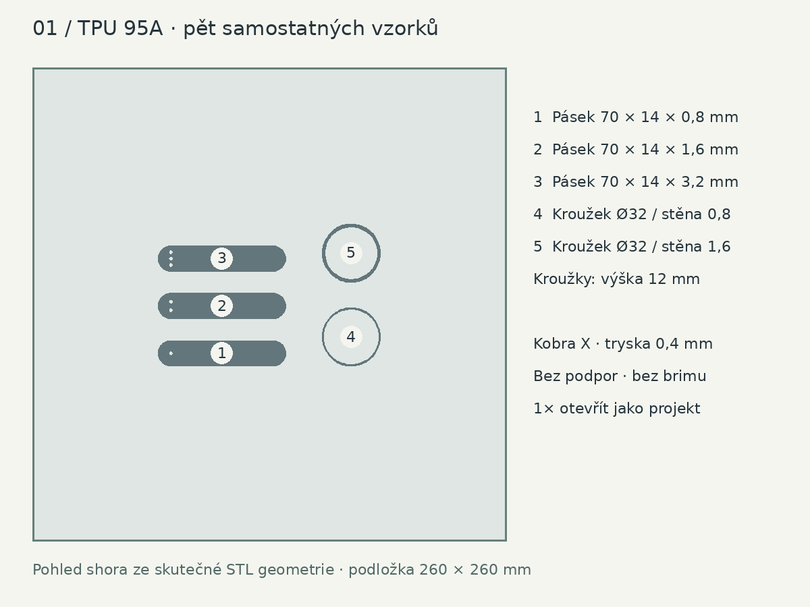

# Jedna podložka – test pružnosti Alzament TPU 95A

**Toto je původní V01, zachovaná pro diagnostiku zastavení11833.** Pro navazující test je připravená samostatná [V02 bez wipe](revize-02-bez-wipe/README.md); její fyzická funkce ani odstranění11833 nejsou potvrzené.

V Anycubic Slicer Next otevři **jednou jako celý projekt** [podlozka-01-kobra-x-alzament-tpu95a-projekt.3mf](podlozka-01-kobra-x-alzament-tpu95a-projekt.3mf). Obsahuje všech **5 samostatných fyzických vzorků**, tiskárnu Kobra X s tryskou 0,4 mm, experimentální materiálový a procesní profil i místně vypočtený G-code. Nic nepřerovnávat ani nemnožit.

Materiál Alzament TPU 95A potvrdil Jiří 24. 10. 2026. Barva a logický filament 1 v souboru neurčují skutečně zavedenou cívku ani fyzický vstup tiskárny. Starší hlášení o vstupu 3 není ověření dnešního zapojení. Profil není fyzicky kalibrovaný. Při přípravě agent tisk nespouštěl; **následný uživatelův pokus 24. 10. 2026 skončil hned na začátku chybou 11833**. Příčina ani oprava nejsou potvrzené; viz [aktuální diagnostika](../diagnostika/2026-10-24-zastaveni-11833/README.md).



| Číslo | Vzorek | Počet | Rozměry CAD |
|---|---|---:|---|
| 1 | Pásek, jedna identifikační dírka | 1 | 70 × 14 × 0,8 mm |
| 2 | Pásek, dvě identifikační dírky | 1 | 70 × 14 × 1,6 mm |
| 3 | Pásek, tři identifikační dírky | 1 | 70 × 14 × 3,2 mm |
| 4 | Tenkostěnný kroužek | 1 | vnější Ø32 mm, výška 12 mm, stěna 0,8 mm |
| 5 | Silnější kroužek | 1 | vnější Ø32 mm, výška 12 mm, stěna 1,6 mm |

Pásky leží širokou plochou na podložce, kroužky stojí na celém kruhovém čele. Geometrie nemá převisy ani nezačíná ve vzduchu. Podpory, raft, brim a pomocná věž jsou vypnuté. Brim by na tenkém kroužku přidal materiál k odstraňování a mohl by zkreslit porovnání. Přilnavost této cívky na skutečné podložce není ověřená. Nejmenší mezera obalových obdélníků je 12 mm, okraj od modelu k hranici 260 × 260 mm je nejméně 69 mm. Tiskové rozmístění je širší než ukázková sestava v CAD.

## Experimentální proces a materiál

| Nastavení | Hodnota |
|---|---|
| Tiskárna | Anycubic Kobra X, tryska 0,4 mm |
| Výška vrstvy / první vrstva | 0,20 / 0,20 mm |
| Stěny | 2, Arachne; tenká kruhová stěna má dvě skutečné obvodové dráhy |
| Jmenovitá šířka čar | 0,40 mm; Arachne může místně šířku upravit |
| Výplň | 100 %, rectilinear |
| Horní / spodní vrstvy | 4 / 4; 0,8 mm |
| První vrstva | 15 mm/s |
| Běžné extruze | nejvýše 25 mm/s, malé obvody a mezery 20 mm/s |
| Běžné zrychlení / první vrstva | 500 / 300 mm/s² |
| Přejezdy | 120 mm/s |
| Maximální objemový průtok | 2,0 mm³/s |
| Násobitel průtoku | 1,0; neověřený kalibrací |
| Tryska první / další vrstvy | 225 / 225 °C |
| Texturovaná tisková podložka | 60 / 60 °C |
| Podpory / brim / raft / věž | vypnuté |
| Odhad sliceru | **1 h 21 min 58 s**, **9,79 g** |

100% výplň drží porovnání soustředěné na tloušťku vzorku a jeho geometrii. Dva perimetry znamenají nastavení stěn kolem hran; na kroužku se uplatní vnitřní i vnější hranice. V 0,8mm stěně je prostor pro dvě dráhy, u 1,6mm stěny jsou ve středních vrstvách čtyři dráhy. Povrchové vrstvy silnějšího kroužku mají i krátké výplňové tahy, což je v náhledu doložené.

Výchozím materiálovým profilem je lokální **Anycubic TPU 95A @Anycubic Kobra X 0.4 nozzle**, nikoli „TPU for ACE“. Profil má původně limit 3,2 mm³/s; zde je snížený na 2,0. Chlazení a retrakce vycházejí z místního profilu tiskárny a TPU a nejsou kalibrací této cívky. Hustota 1,24 g/cm³ je převzatá z profilu Anycubic, ne změřená pro Alzament, proto je hmotnost pouze odhad.

### Zachované teplotní varování

Slicer při podložce **60 °C** hlásí **`bed_temperature_too_high_than_filament`**. Varování je zachované v 3MF i kontrolním JSON; nebylo obcházeno změnou teploty skelného přechodu materiálu.

Podklady Alzamentu se rozcházejí: [technický list TPU 95A](https://dwn.alza.cz/manual/161249) uvádí trysku **220–240 °C** a podložku **60–80 °C**, zatímco [produktová stránka Gray](https://www.alza.cz/alzament-tpu-95a-1-kg-gray-d13015353.htm) uvádí **190–230 °C / 30–50 °C**. Tyto hodnoty byly aktuálně ověřeny 24. 10. 2026. **225/60 °C je experimentální návrh podle technického listu**, nikoli vyřešení rozporu, údaj ze skutečné cívky nebo potvrzený tiskový profil. Teploty uvedené na konkrétní cívce mají být před fyzickým tiskem porovnány s tímto návrhem.

Druhé varování `not_support_traditional_timelapse` se týká nepodporovaného časosběru. Slicer nehlásí přesah podložky a nevytváří podpory. Nejde o záruku úspěšného výtisku ani mechanických vlastností.

## Co je ověřeno

- Geometry-only alternativa i nastavený projekt obsahují právě 5 samostatných objektů v měřítku 1:1. Po importu a řezání zůstal počet trojúhelníků, vrcholy a poloha každého objektu zachované do 0,001 mm. Slicer neprovedl opravy sítí.
- Nastavený projekt vznikl nativním exportem Anycubic Slicer Next, byl znovu načten a nařezán. Předávaný 3MF obsahuje G-code a všechny očekávané nastavené hodnoty.
- Všech 5 vzorků má extruzi na první vrstvě. Pásky mají 4 / 8 / 16 vrstev, oba kroužky všech 60 vrstev do Z 12 mm.
- U obou kroužků je na každé vrstvě doložen vnitřní i vnější pás obvodových drah kolem celého kruhu: všech 72 úhlových intervalů po 5°. Tenká stěna 0,8 mm při řezání nezmizela.
- Vzorkování skutečných drah po nejvýše 0,15 mm na síti 0,25 mm nenalezlo bod vzdálený více než 0,5 mm od drah předchozí vrstvy. Jde o digitální kontrolu návaznosti, ne měření spojení vrstev.
- Nejvyšší přikázaná extruzní rychlost je 25,0 mm/s. Objemový průtok na segmentech dlouhých nejméně 0,1 mm dosahuje 2,003 mm³/s; rozdíl od limitu odpovídá zaokrouhlení souřadnic a extruze. Na velmi krátkých úsecích vychází ze zaokrouhleného G-code až 2,151 mm³/s, proto je neuvažujeme jako přesné měření průtoku.
- Vizuálně zkontrolován [přehled skutečných drah](podlozka-01-vrstvy.png) na Z 0,2 / 0,8 / 1,6 / 3,2 / 6 / 12 mm a [detail obou kroužků](krouzky-detail-drah.png).

Fyzický tisk, přilnavost, pružnost, trvalá deformace a pevnost vrstev nejsou ověřené.

## Soubory a regenerace

- [Nastavený a nařezaný projekt](podlozka-01-kobra-x-alzament-tpu95a-projekt.3mf) – hlavní předávaná podložka.
- [Pouze geometrie](podlozka-01-geometrie.3mf) – alternativní soubor se stejnými pěti díly a polohami; **neobsahuje proces, materiál ani G-code** a nepřepisuje presety. Nepřidávat vedle hlavního projektu jako dalších pět kusů.
- [Kontrola rozmístění](kontrola-rozlozeni.json), [kontrola řezání a drah](kontrola-rezani.json).
- [Proces](proces-kobra-x-tpu-navrh.json), [materiál](filament-alzament-tpu95a-navrh.json).
- [Reprodukovatelný generátor](pripravit-podlozku.py).

Z kořene repozitáře:

```bash
python3 models/tpu-test-pruznosti/rozlozeni/pripravit-podlozku.py
```

Generátor čte aktuálních pět souborů STL, přepíše pouze výstupy v této složce, zachová popsané orientace, profily a rozmístění a opakuje digitální kontroly. Potřebuje Python s Pillow a nainstalovaný Anycubic Slicer Next s místními profily Kobra X. Přepínač `--geometry-only` vytváří jen geometrickou alternativu a její náhled/kontrolu. Mezisoubory a izolovaný lokální adresář sliceru jsou v ignorované `.cache/`. Skript nikdy neodesílá data do tiskárny.
