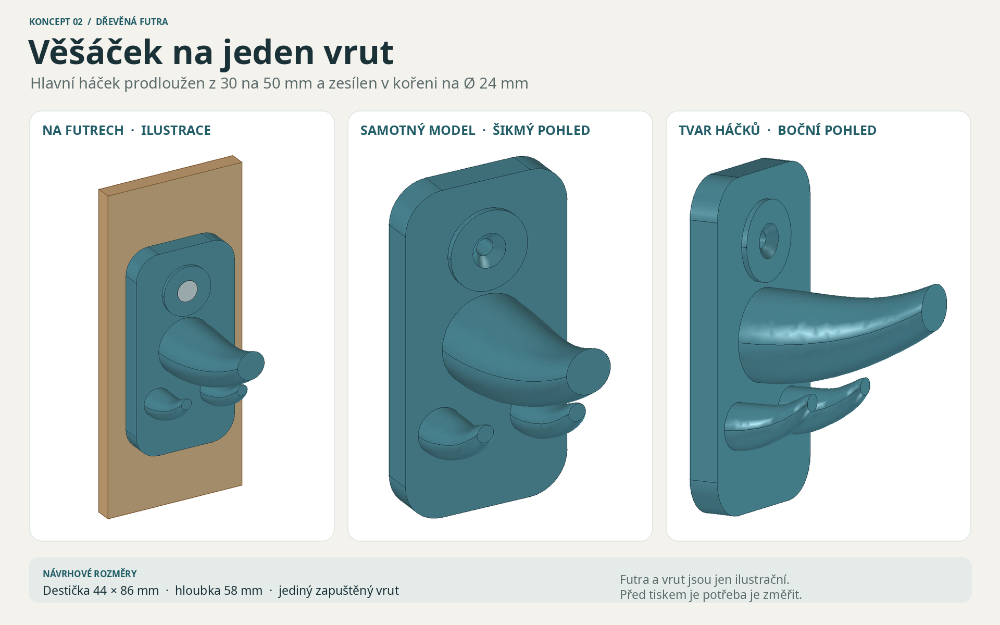

# Věšáček na dřevěná futra – vizuální návrh 02

Jeden díl s oblou dosedací destičkou, jediným otvorem pro vrut a třemi mírně zvednutými háčky. Po Jiřího požadavku je **hlavní háček prodloužen z 30 na 50 mm od čela destičky** a zesílen v kořeni z Ø 17 na Ø 24 mm. Špička má Ø 12 mm; destička je silnější. Zamýšlen je pro **drobné předměty** (svinovací metr, kleště, izolepu či kabely). Vyobrazené dřevo a hlava vrutu jsou pouze orientační CAD reference; žádné konkrétní futro ani vrut dosud nebyly změřeny. Použití pro reproduktor ani jiná těžší břemena není potvrzené.

## Rozměry a původ

| Parametr | Hodnota | Původ |
|---|---:|---|
| Destička šířka × výška × tloušťka | 44 × 86 × 8 mm | Návrhový předpoklad |
| Celková hloubka od zadní dosedací roviny | 58 mm | Výsledek CAD návrhu |
| Hlavní háček: vyložení od čela / zdvih konce | 50 / 12 mm | Návrhový předpoklad po požadavku na delší háček |
| Hlavní háček: průměr kořene / špičky | Ø 24 / Ø 12 mm | Návrhový předpoklad pro mohutnější tvar |
| Boční háčky: vyložení od čela / zdvih konce | 22 / 8 mm | Návrhový předpoklad |
| Průchozí otvor / ústí zapuštění hlavy | Ø 4,5 / Ø 9 mm | Návrhový předpoklad; ověřit podle vrutu |
| Počet vrutů | 1 | Zadání uživatele |

Destička má rovnou širokou zadní plochu. Přítlak vrutu a tření o dřevo mohou omezit pootočení, ale **jeden vrut je sám o sobě nezaručuje**. Delší háček zároveň zvětšuje páku na kořen a uchycení. Definitivní tvar dosednutí nebo případná tenká protiskluzová vložka se mají zvolit až podle skutečného profilu futer a zátěže. Žádná únosnost, dosednutí, vůle dveří ani fyzický tisk nebyly ověřeny.

## Soubory

- [vizualizace-vesacek-na-futra.png](vizualizace-vesacek-na-futra.png) – přehled skutečných CAD záběrů; dřevo a vrut jsou jen ilustrační reference.
- [vesacek.FCStd](vesacek.FCStd) – editovatelný FreeCAD dokument s tabulkou **Parametry (mm)**, standardními objekty a výrazy; při otevření je viditelný finální model.
- [vesacek.FCMacro](vesacek.FCMacro) – zdrojové makro. **Při spuštění přepíše** zdejší FCStd, STL a kontrolní JSON; následně je potřeba spustit [nahled.FCMacro](nahled.FCMacro) pro PNG a uloženou viditelnost.
- [stl/vesacek.stl](stl/vesacek.stl) – export geometrie, nikoli sám o sobě připravená tisková úloha.
- [kontrola-modelu.json](kontrola-modelu.json) – výsledky počítačové kontroly geometrie a otevření uloženého dokumentu.
- [kontrola-pristupu.json](kontrola-pristupu.json) a [kontrolní makro](overit-pristup.FCMacro) – CAD odstupy od výztuhy vrutu, bočních háčků a pouze ilustračního bitu Ø 8 mm.
- [sestav-nahled.py](sestav-nahled.py) – spojí FreeCAD PNG záběry do přehledové tabule.
- [Historie původního 30mm návrhu](historie/navrh-01-30mm/README.md) – archivovaný předchozí model, nikoli aktuální verze.
- [rozlozeni/podlozka-01-kobra-x-pla-projekt.3mf](rozlozeni/podlozka-01-kobra-x-pla-projekt.3mf) – jedna připravená podložka pro Anycubic Kobra X 0,4 mm; [popis nastavení a omezení](rozlozeni/README.md). Soubory jsou připravené pro případné další posouzení, nyní je uživateli předkládán jen náhled.

## Ověření a další krok

FreeCAD 1.1.3 potvrdil platné **jedno těleso 44 × 58 × 86 mm**. STL je po opětovném načtení uzavřená síť s jednou komponentou. Uložený FCStd byl znovu otevřen; zobrazoval pouze finální model a zkušební změny šířky 44 → 46 → 44 mm a vyložení hlavního háku 50 → 52 → 50 mm se přepočítaly. Skutečné PNG vzniklo snímáním CAD geometrie ve FreeCADu.

Samostatná CAD kontrola našla **2,0 mm** odstup hlavního háku od ilustračního přímého bitu Ø 8 mm v ose vrutu, 1,5 mm od kruhové výztuhy kolem vrutu a přes 6,4 mm od bočních háčků. Skutečný šroubovák, úhel nasazení a přístup rukou tím ověřeny nejsou.

Aktuální [Kobra X podložka](rozlozeni/README.md) obsahuje právě jeden delší věšáček se zadní plochou na podložce, 5 stěnami, 100% výplní a 5mm lemem. Místní řez vytvořil **290 vrstev** bez drah podpor a mostů; šest vrstev bylo vykresleno ze skutečného G-code. Dvě drobná místa na uzavření bočních špiček mají ve vzorkované kontrole odstup od předchozí dráhy asi 0,56 mm, žádné přes 1 mm. CLI současně zapsalo chybu `calc_exclude_triangles`, takže řez nepovažujeme za bezchybný důkaz tisknutelnosti. Odhad sliceru je 57,23 g / asi 3 h 12 min; skutečný výtisk a pevnost ověřeny nejsou. Předchozí 185vrstvá podložka patřila ke kratší verzi a je nahrazena.

Před případným tiskem změřit **šířku a tvar futer, prostor při otevírání dveří, průměr/délku vrutu, průměr jeho hlavy a hmotnost i způsob zavěšení předmětů**. Pak doladit upevnění a zkontrolovat tiskovou orientaci, vrstvy a případné podpory. Tento návrh je nyní předložen jen k vizuálnímu posouzení; výsledek na skutečných futrech ani tisk se netvrdí.
